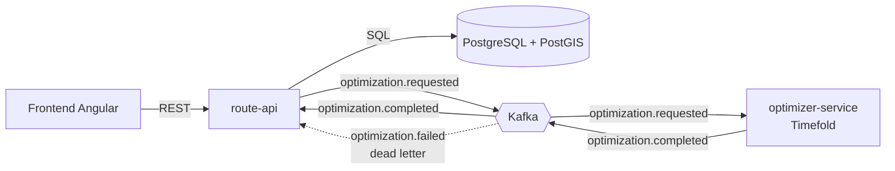

# RutaFlex

[](https://github.com/delmocss/rutaflex/actions/workflows/ci.yml)

Optimización de rutas de reparto para una pequeña empresa de paquetería: recibe las paradas del día y la flota disponible y devuelve **una ruta por furgoneta** que respeta capacidad y franjas horarias.

> Estado: **en construcción** (MVP previsto para el 31 de enero). Hoy hay esqueleto, API de datos (almacenes, furgonetas, paradas) e importación CSV; el optimizador y Kafka llegan en las siguientes fases. Esta tabla se actualiza con cada fase.

| Fase | Contenido | Estado |
|---|---|---|
| 1 | Esqueleto: Maven multi-módulo, `docker compose`, Flyway, CI | ✅ |
| 2 | Almacén, furgonetas y paradas (PostGIS), importación CSV, dataset de ejemplo | ✅ |
| 2b | UI de solo lectura (Angular + Leaflet): ver almacén, furgonetas y paradas en el mapa | ⏳ |
| 3 | Optimizador con Timefold y sus restricciones | ⏳ |
| 4-5 | Kafka: trabajo asíncrono, idempotencia, dead letter, test de extremo a extremo | ⏳ |
| 6 | Restricciones reales y medición de km ahorrados | ⏳ |
| 7 | Angular + Leaflet y JWT con dos roles | ⏳ |
| 8-9 | Despliegue, documentación y vídeo | ⏳ |

## Arquitectura

Dos servicios Spring Boot en un mismo repositorio que **solo se hablan a través de Kafka**. La API es la única que toca la base de datos.



| Módulo | Qué es |
|---|---|
| `common-events` | Contrato entre servicios: nombres de topics y eventos. Java puro, sin Spring. |
| `route-api` | API REST y dueña de los datos (Flyway + PostGIS). |
| `optimizer-service` | Consume el problema, calcula las rutas y publica el resultado. Sin base de datos. |

## Stack

Java 21 · Spring Boot 3.5 · Maven multi-módulo · PostgreSQL 16 + PostGIS · Flyway · Apache Kafka (modo KRaft) · Timefold Solver 1.x · JUnit 5 + Testcontainers.

Timefold 1.x y no 2.x porque la línea 2.x exige Spring Boot 4 y este proyecto usa Spring Boot 3.

## Ejecutarlo en local

Requisitos: JDK 21, Maven 3.9+ y Docker.

```bash
docker compose up -d                       # PostGIS + Kafka + topics
mvn -B verify                              # compila y pasa todos los tests

mvn -pl route-api spring-boot:run          # http://localhost:8080/actuator/health
mvn -pl optimizer-service spring-boot:run  # http://localhost:8081/actuator/health
```

`docker compose down -v` lo para y borra los datos.

## API de datos (`route-api`)

Sin autenticación por ahora: el JWT con dos roles llega en la fase de seguridad. Los errores salen como `application/problem+json` (RFC 7807) y los mensajes de validación siempre en inglés.

| Método y ruta | Qué hace |
|---|---|
| `POST /api/warehouses` · `GET /api/warehouses` · `GET/PUT/DELETE /api/warehouses/{id}` | Almacén (punto de salida). No se puede borrar si tiene trabajos de optimización (409). |
| `POST/GET /api/warehouses/{id}/vehicles` · `GET/PUT/DELETE /api/vehicles/{id}` | Furgonetas: capacidad en bultos y jornada. Nombre único por almacén. |
| `POST /api/stops` · `GET /api/stops?date=` · `GET/PUT/DELETE /api/stops/{id}` | Paradas de un día, con franja horaria opcional (completa o ninguna). |
| `GET /api/stops/dates` | Días con paradas, con totales de paradas y bultos. |
| `DELETE /api/stops?date=` | Borra todas las paradas de un día. |
| `POST /api/stops/import?date=&replace=` | Importa un CSV (campo `file`). Todo o nada. |

### Importación CSV

```csv
address,lat,lon,parcels,window_start,window_end
"Calle Mayor 1, Pinto",40.2428,-3.6997,3,09:00,11:00
Calle Real 5 Getafe,40.3057,-3.7329,1,,
```

UTF-8 estricto (con o sin BOM; si el fichero está en ANSI/Windows-1252 se rechaza en vez de guardar acentos corruptos), separador coma, decimales con punto (sin exponentes ni `NaN`). Columnas obligatorias: `address`, `lat`, `lon`, `parcels`; opcionales `window_start` y `window_end` (HH:mm, ambas o ninguna). El orden de las columnas y las mayúsculas dan igual. **Si una sola fila es inválida no se importa ninguna**, y la respuesta lista cada problema con su línea del fichero (la cabecera es la 1). Máximo 1000 filas (`rutaflex.import.max-rows`). Con `replace=true` se sustituyen las paradas de ese día en una sola transacción y bajo un bloqueo por día (dos reemplazos simultáneos se ejecutan uno tras otro): si algo falla, el día queda como estaba. Las paradas se devuelven siempre en el orden del fichero: es la base de la comparación «sin optimizar».

### Datos de ejemplo

El dataset de Madrid sur (80 paradas en Valdemoro, Pinto y Getafe, 205 bultos, 28 con franja horaria) es **sintético**: las direcciones son inventadas y las coordenadas se muestrean dentro del casco urbano de cada municipio; no son portales reales. Lo genera `data/generate_madrid_sur_stops.py` con semilla fija, así que es reproducible.

```bash
docker compose up -d postgis
RUTAFLEX_SAMPLE_DATA_ENABLED=true RUTAFLEX_SAMPLE_DATA_DELIVERY_DATE=2026-12-14   mvn -pl route-api spring-boot:run
```

Crea un almacén, cuatro furgonetas (4 × 60 bultos) y las 80 paradas, todo en una transacción. Solo actúa si la base de datos está vacía y nunca borra nada.

## Tests

`mvn verify` ejecuta, por módulo:

- `common-events`: los eventos viajan como JSON y vuelven iguales.
- `route-api`: PostgreSQL + PostGIS **reales** con Testcontainers (nunca H2), con un único contenedor compartido: migraciones de Flyway, geografía en metros, restricciones del esquema, los CRUD de almacenes, furgonetas y paradas, la importación CSV (todo o nada, errores por fila, `replace` atómico) y el dataset de ejemplo.
- `optimizer-service`: arranca y responde en `/actuator/health`.

El CI de GitHub Actions ejecuta el mismo `mvn verify`.
