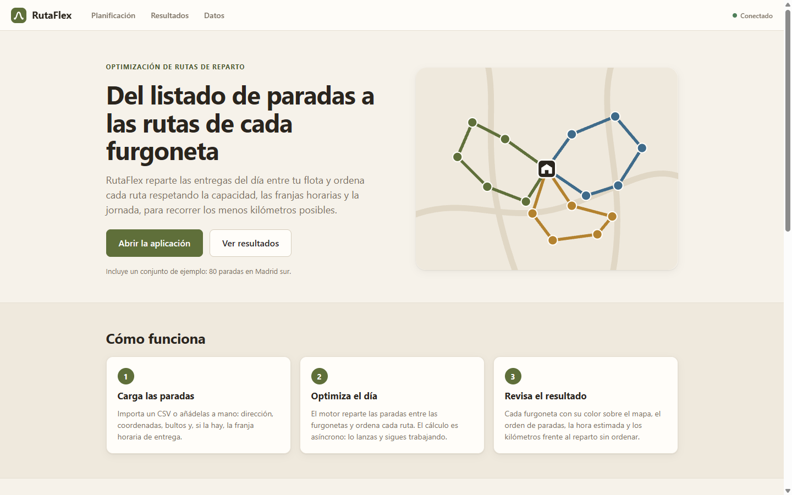
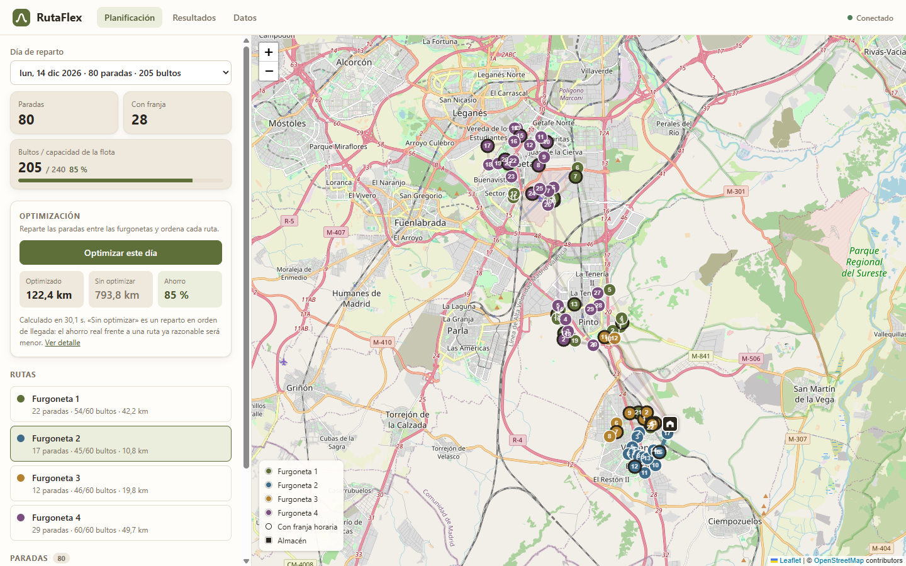
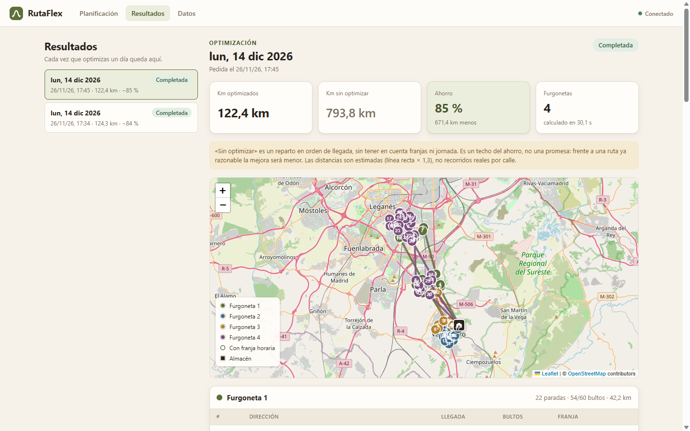
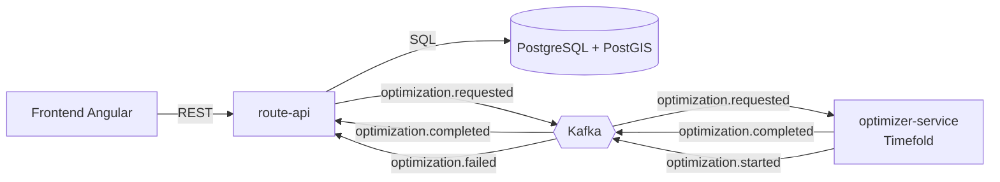

# RutaFlex

[](https://github.com/delmocss/rutaflex/actions/workflows/ci.yml)

Optimización de rutas de reparto para una pequeña empresa de paquetería: recibe las paradas del día y la flota disponible y devuelve **una ruta por furgoneta** que respeta capacidad y franjas horarias.

> Estado: **en construcción** (MVP previsto para el 31 de enero). Hoy hay esqueleto, API de datos (almacenes, furgonetas, paradas), importación CSV y una UI para verlo todo en un mapa; el optimizador y Kafka llegan en las siguientes fases. Esta tabla se actualiza con cada fase.

| Fase | Contenido | Estado |
|---|---|---|
| 1 | Esqueleto: Maven multi-módulo, `docker compose`, Flyway, CI | ✅ |
| 2 | Almacén, furgonetas y paradas (PostGIS), importación CSV, dataset de ejemplo | ✅ |
| 2b | UI (Angular + Leaflet): portada, planificación con rutas sobre el mapa, historial de resultados y gestión de datos (sin login todavía) | ✅ |
| 3 | Optimizador con Timefold (resuelve solo, sin Kafka): restricciones y comparación con la línea base | ✅ |
| 4 | Kafka: trabajo asíncrono con estado (202 + id), consumidores idempotentes, test de extremo a extremo | ✅ |
| 5 | Opcionales de Kafka: outbox, dead letter con reintentos por topic, métricas Micrometer | ⏳ |
| 6 | Restricciones reales y medición de km ahorrados | ⏳ |
| 7 | JWT con dos roles (COORDINADOR / REPARTIDOR) en el backend y en la UI | ⏳ |
| 8-9 | Despliegue, documentación y vídeo | ⏳ |

## Interfaz

Angular 21 + Leaflet (`frontend/`), con cuatro vistas y una paleta cálida y apagada:

| Vista | Qué hace |
|---|---|
| **Inicio** | Portada: qué es RutaFlex, cómo funciona, qué restricciones respeta, la medición (con su advertencia) y el stack |
| **Planificación** | Elige un día y pulsa **Optimizar**: se ve el avance (en cola → calculando → completado) y las rutas aparecen sobre el mapa, cada furgoneta de un color con el orden de sus paradas; al pulsar una ruta se resalta |
| **Resultados** | Historial de optimizaciones y, de cada una, los km optimizados y sin optimizar, el ahorro, el mapa y una tabla por furgoneta con la hora estimada y la franja de cada parada |
| **Datos** | Alta, edición y borrado de paradas (por día), furgonetas y almacén, más la importación CSV |





Cuida los detalles de uso: los mensajes de la API se muestran en español (también el motivo de un cálculo fallido); si cambias las paradas de un día después de optimizar, avisa de que el resultado ya no es vigente en vez de dibujar rutas que no cuadran; los trazados son líneas rectas entre paradas (no hay red viaria) y así se indica. Detalles en [`frontend/README.md`](frontend/README.md).

```bash
docker compose up -d
RUTAFLEX_SAMPLE_DATA_ENABLED=true mvn -pl route-api spring-boot:run   # API con los datos de ejemplo
mvn -pl optimizer-service spring-boot:run                              # el optimizador (para poder pulsar «Optimizar»)
cd frontend && npm install && npm start                                # http://localhost:4200
```

## Arquitectura

Dos servicios Spring Boot en un mismo repositorio que **solo se hablan a través de Kafka**. La API es la única que toca la base de datos.



| Módulo | Qué es |
|---|---|
| `common-events` | Contrato entre servicios: nombres de topics y eventos. Java puro, sin Spring. |
| `route-api` | API REST y dueña de los datos (Flyway + PostGIS). Pide las optimizaciones y guarda su estado y resultado. |
| `optimizer-service` | Consume el problema, calcula las rutas y publica el resultado. Sin base de datos. |
| `frontend` | UI Angular + Leaflet (no es un módulo Maven). |
| `e2e-tests` | Prueba de extremo a extremo: PostGIS y Kafka reales y los dos servicios empaquetados, cada uno en su proceso. |

## Stack

Java 21 · Spring Boot 3.5 · Maven multi-módulo · PostgreSQL 16 + PostGIS · Flyway · Apache Kafka (modo KRaft) · Timefold Solver 1.x · JUnit 5 + Testcontainers · Angular 21 + Leaflet.

Timefold 1.x y no 2.x porque la línea 2.x exige Spring Boot 4 y este proyecto usa Spring Boot 3.

## Ejecutarlo en local

Requisitos: JDK 21, Maven 3.9+ y Docker.

```bash
docker compose up -d                       # PostGIS + Kafka + topics
mvn -B verify                              # compila y pasa todos los tests

mvn -pl route-api spring-boot:run          # http://localhost:8080/actuator/health
mvn -pl optimizer-service spring-boot:run  # http://localhost:8081/actuator/health
```

Con la API, el optimizador, PostGIS y Kafka en marcha (y los datos de ejemplo cargados, ver más abajo):

```bash
curl -i -X POST localhost:8080/api/optimizations -H 'Content-Type: application/json' \
     -d '{"deliveryDate": "2026-12-14"}'      # 202 + Location: /api/optimizations/{id}
curl localhost:8080/api/optimizations/{id}    # QUEUED -> RUNNING -> COMPLETED (con las rutas)
```

`docker compose down -v` lo para y borra los datos.

## API de datos (`route-api`)

Sin autenticación por ahora: el JWT con dos roles llega en la fase de seguridad. Los errores salen como `application/problem+json` (RFC 7807) y los mensajes de validación siempre en inglés.

| Método y ruta | Qué hace |
|---|---|
| `POST /api/warehouses` · `GET /api/warehouses` · `GET/PUT/DELETE /api/warehouses/{id}` | Almacén (punto de salida). No se puede borrar si tiene trabajos de optimización (409). |
| `POST/GET /api/warehouses/{id}/vehicles` · `GET/PUT/DELETE /api/vehicles/{id}` | Furgonetas: capacidad en bultos y jornada. Nombre único por almacén. |
| `POST /api/stops` · `GET /api/stops?date=` · `GET/PUT/DELETE /api/stops/{id}` | Paradas de un día, con franja horaria opcional (completa o ninguna). |
| `GET /api/stops/dates` | Días con paradas, con totales de paradas y bultos. |
| `DELETE /api/stops?date=` | Borra todas las paradas de un día. |
| `POST /api/stops/import?date=&replace=` | Importa un CSV (campo `file`). Todo o nada. |

### Importación CSV

```csv
address,lat,lon,parcels,window_start,window_end
"Calle Mayor 1, Pinto",40.2428,-3.6997,3,09:00,11:00
Calle Real 5 Getafe,40.3057,-3.7329,1,,
```

UTF-8 estricto (con o sin BOM; si el fichero está en ANSI/Windows-1252 se rechaza en vez de guardar acentos corruptos), separador coma, decimales con punto (sin exponentes ni `NaN`). Columnas obligatorias: `address`, `lat`, `lon`, `parcels`; opcionales `window_start` y `window_end` (HH:mm, ambas o ninguna). El orden de las columnas y las mayúsculas dan igual. **Si una sola fila es inválida no se importa ninguna**, y la respuesta lista cada problema con su línea del fichero (la cabecera es la 1). Máximo 1000 filas (`rutaflex.import.max-rows`). Con `replace=true` se sustituyen las paradas de ese día en una sola transacción y bajo un bloqueo por día (dos reemplazos simultáneos se ejecutan uno tras otro): si algo falla, el día queda como estaba. Las paradas se devuelven siempre en el orden del fichero: es la base de la comparación «sin optimizar».

### Datos de ejemplo

El dataset de Madrid sur (80 paradas en Valdemoro, Pinto y Getafe, 205 bultos, 28 con franja horaria) es **sintético**: las direcciones son inventadas y las coordenadas se muestrean dentro del casco urbano de cada municipio; no son portales reales. Lo genera `data/generate_madrid_sur_stops.py` con semilla fija, así que es reproducible.

```bash
docker compose up -d postgis
RUTAFLEX_SAMPLE_DATA_ENABLED=true RUTAFLEX_SAMPLE_DATA_DELIVERY_DATE=2026-12-14   mvn -pl route-api spring-boot:run
```

Crea un almacén, cuatro furgonetas (4 × 60 bultos) y las 80 paradas, todo en una transacción. Solo actúa si la base de datos está vacía y nunca borra nada.

## Optimizaciones asíncronas

Calcular las rutas tarda segundos, así que la API no espera: guarda un trabajo, lo manda a Kafka y responde enseguida.

```
POST /api/optimizations   {"deliveryDate": "2026-12-14", "warehouseId": "…" (opcional si solo hay uno)}
  → 202 Accepted + Location, con el trabajo en estado QUEUED
GET  /api/optimizations/{id}                 estado, y las rutas cuando está COMPLETED
GET  /api/optimizations?date=2026-12-14      los más recientes (sin rutas)
```

| Estado | Significado |
|---|---|
| `QUEUED` | Guardado y publicado en Kafka |
| `RUNNING` | El optimizador ha empezado a calcular |
| `COMPLETED` | Hay rutas por furgoneta, `totalKm` y `baselineKm` |
| `FAILED` | Sin solución (un motivo legible en `failureReason`) o el optimizador no pudo procesarlo |

Errores: **422** si no hay almacén, furgonetas o paradas para ese día; **409** si ya hay un cálculo en curso para ese almacén y día (lo garantiza un índice único parcial en la base de datos, no solo el código); **503** si el mensaje no se entrega a Kafka en unos segundos (el trabajo queda `FAILED`; el productor tiene plazos acotados, así que la petición HTTP no espera un minuto).

**Idempotencia.** Kafka entrega *al menos una vez*, así que cualquier mensaje puede llegar repetido o fuera de orden. La API aplica cada resultado con un `UPDATE … WHERE status IN (…)`: la base de datos decide de forma atómica si el mensaje aún procede, de modo que un resultado repetido, un aviso de inicio tardío o un `failed` posterior a un `completed` no cambian nada (los estados finales no se deshacen). El optimizador, que no tiene base de datos, recuerda los últimos trabajos atendidos para no recalcular un duplicado; eso solo ahorra CPU, la garantía está en la API.

**Fallos y trabajos atascados.** Cada camino conocido acaba en `FAILED` en vez de quedarse esperando:

- Un problema sin solución es definitivo: se publica `optimization.failed` sin reintentar.
- Un fallo inesperado del optimizador se reintenta dos veces (sin recalcular si lo que falló fue publicar el resultado) y, si persiste, publica `optimization.failed`.
- Una petición ilegible cuyo trabajo se identifica (la clave del mensaje es su id) también publica `optimization.failed`; si no hay forma de saber de qué trabajo es, se descarta con un log sin bloquear los siguientes.
- La API reintenta durante un minuto (pausas crecientes) si no puede guardar un resultado, por ejemplo con la base de datos caída.
- Las peticiones con más de una hora (por ejemplo, al reiniciar el optimizador con un grupo nuevo, que relee el topic) se ignoran: la API ya habrá cerrado ese trabajo.

Y como red de seguridad para lo que ninguno de esos caminos cubra (un mensaje perdido, el proceso muriendo entre guardar y publicar, la base de datos caída más de un minuto), un **vigilante** en la API marca `FAILED` todo trabajo `QUEUED` o `RUNNING` que lleve más de 10 minutos (`RUTAFLEX_JOBS_TIMEOUT`), con el motivo «su resultado nunca llegó», y ese día puede volver a pedirse. Si el resultado llegase tarde, se ignora: `FAILED` es final.

**Limitación conocida.** Guardar el trabajo y publicar el mensaje son dos pasos; si el proceso muere entre ambos el trabajo espera hasta que el vigilante lo cierra (10 minutos) en vez de arrancar solo. El patrón *outbox* lo resolvería del todo y es la mejora de la Fase 5.

## Optimizador (`optimizer-service`)

Reparte las paradas entre las furgonetas y ordena cada ruta con [Timefold Solver](https://timefold.ai). `RouteOptimizer` recibe un `OptimizationRequested` y devuelve un `OptimizationCompleted`, sin saber nada de Kafka; `OptimizationHandler` y el listener lo conectan al broker. El tiempo de cálculo por trabajo se configura con `OPTIMIZER_SPENT_LIMIT` (30 s por defecto) y `OPTIMIZER_UNIMPROVED_LIMIT` (8 s).

| Restricción | Tipo | Qué hace |
|---|---|---|
| Capacidad | dura | Los bultos de una furgoneta no pueden superar su capacidad |
| Franja horaria | dura | No se puede llegar a una parada después de que cierre su franja; llegar antes solo implica esperar |
| Fin de jornada | dura | La furgoneta debe estar de vuelta en el almacén antes de que acabe su turno |
| Distancia | blanda | Minimiza los metros totales, contando la salida del almacén y la vuelta |

Si el problema no tiene solución (más bultos que capacidad, una franja imposible, un turno demasiado corto) se rechaza con un mensaje que explica el motivo.

**Supuestos del modelo.** No hay red viaria: la distancia es la de la línea recta multiplicada por 1,3 (rodeo urbano típico) y la velocidad media es de 30 km/h; cada parada tarda 2 min más 30 s por bulto. Son estimaciones, no rutas reales por calle. Se aplican igual a la solución y a la línea base (mismas distancias), pero la línea base es más simple que la solución —no mira franjas ni jornada—, así que la comparación mide distancia, no viabilidad.

**Medición con el dataset de 80 paradas** (4 furgonetas de 60 bultos, hasta 20 s de cálculo, semilla fija):

| | km |
|---|---|
| Línea base: paradas en el orden de llegada, cada una en la primera furgoneta con hueco | 793,8 |
| Optimizado | 122,5 |

Una reducción del 85 %, pero **hay que leerla con cuidado**: las paradas del CSV llegan mezcladas entre tres municipios, así que la línea base es deliberadamente ingenua (cada furgoneta salta de un pueblo a otro) y además no respeta las franjas horarias. Un despachante real ordenaría al menos por zonas. Esa cifra es el techo del ahorro, no una promesa; la Fase 6 añade una referencia más exigente (vecino más cercano por zona) para dar un número defendible. La búsqueda tiene un límite de tiempo, así que el resultado exacto varía un poco entre ejecuciones; los tests solo exigen umbrales holgados.

## Tests

`mvn verify` ejecuta, por módulo:

- `common-events`: los eventos viajan como JSON y vuelven iguales.
- `route-api`: PostgreSQL + PostGIS **reales** con Testcontainers (nunca H2), con un único contenedor compartido: migraciones de Flyway, geografía en metros, restricciones del esquema, los CRUD de almacenes, furgonetas y paradas, la importación CSV (todo o nada, errores por fila, `replace` atómico) y el dataset de ejemplo.
- `route-api` (trabajos): con PostGIS **y Kafka reales** — pedir una optimización (202, mensaje publicado con el problema completo y las paradas en su orden), conflictos y datos que faltan, el consumo de resultados con mensajes repetidos, tardíos, de trabajos desconocidos e ilegibles (comprobado por mutación: quitar la condición de estado de cualquier transición hace fallar los tests), el vigilante de trabajos atascados (programado de verdad, no llamado a mano) y el fallo al encolar incluso cuando tampoco se puede guardar el fallo.
- `optimizer-service`: la lógica de atender una petición sin Kafka (inicio y resultado, duplicado ignorado, problema imposible, reintento sin recalcular, petición antigua), los caminos de fallo (petición ilegible con y sin trabajo identificable, un aviso que tampoco se puede publicar sin provocar bucles) y cada restricción de Timefold aislada con `ConstraintVerifier` y números calculables a mano (17 tests), la resolución del dataset de 80 paradas verificada con un cálculo independiente de km, capacidad, franjas y vuelta al almacén, una ejecución con `FULL_ASSERT` (comprueba que la puntuación incremental del solver coincide con la recalculada), la validación de entradas incorrectas y los problemas imposibles, que se rechazan con su motivo. Además, `OptimizerApplicationTest` comprueba que el servicio arranca y responde en `/actuator/health`.
- `e2e-tests`: **PostGIS y Kafka reales y los dos jars ejecutables** (los que se desplegarían), cada uno en su proceso. Optimiza el día de 80 paradas de punta a punta y comprueba que cada parada aparece una vez, la capacidad y las franjas; que los problemas imposibles acaban `FAILED` con su motivo; que un mensaje duplicado no se recalcula (el optimizador publica un solo resultado); que la basura en el topic no bloquea los siguientes; que una petición ilegible de un trabajo conocido lo deja `FAILED`; y el 409 con un trabajo activo. Se ejecuta con failsafe en `mvn verify`.
- `frontend`: 95 tests unitarios con Vitest (lógica de dominio y de rutas, traducción de errores, formularios y los dos estados —datos y optimizaciones—, incluidas las respuestas que llegan fuera de orden) más `npm run build` y el formato con Prettier.

El CI de GitHub Actions ejecuta `mvn verify` y los comandos del frontend.
