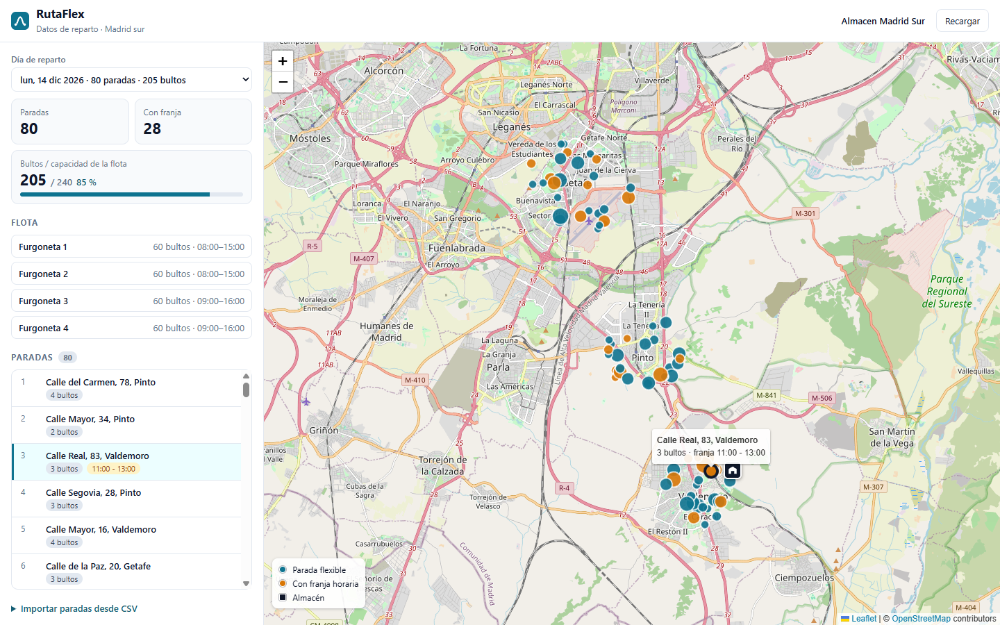
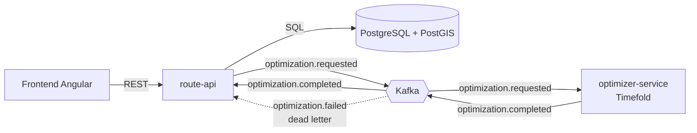

# RutaFlex

[](https://github.com/delmocss/rutaflex/actions/workflows/ci.yml)

Optimización de rutas de reparto para una pequeña empresa de paquetería: recibe las paradas del día y la flota disponible y devuelve **una ruta por furgoneta** que respeta capacidad y franjas horarias.

> Estado: **en construcción** (MVP previsto para el 31 de enero). Hoy hay esqueleto, API de datos (almacenes, furgonetas, paradas), importación CSV y una UI para verlo todo en un mapa; el optimizador y Kafka llegan en las siguientes fases. Esta tabla se actualiza con cada fase.

| Fase | Contenido | Estado |
|---|---|---|
| 1 | Esqueleto: Maven multi-módulo, `docker compose`, Flyway, CI | ✅ |
| 2 | Almacén, furgonetas y paradas (PostGIS), importación CSV, dataset de ejemplo | ✅ |
| 2b | UI de solo lectura (Angular + Leaflet): almacén, furgonetas y paradas en el mapa, e importación CSV | ✅ |
| 3 | Optimizador con Timefold (resuelve solo, sin Kafka): restricciones y comparación con la línea base | ✅ |
| 4-5 | Kafka: trabajo asíncrono, idempotencia, dead letter, test de extremo a extremo | ⏳ |
| 6 | Restricciones reales y medición de km ahorrados | ⏳ |
| 7 | Angular + Leaflet y JWT con dos roles | ⏳ |
| 8-9 | Despliegue, documentación y vídeo | ⏳ |

## Interfaz



Angular 21 + Leaflet (`frontend/`): elige el día de reparto, ve el resumen (paradas, bultos frente a la capacidad de la flota), la flota y las paradas en la lista y en el mapa (ámbar = con franja horaria), e importa un CSV desde el panel. Los errores de la API se muestran en español, línea a línea. Detalles en [`frontend/README.md`](frontend/README.md).

```bash
docker compose up -d postgis
RUTAFLEX_SAMPLE_DATA_ENABLED=true mvn -pl route-api spring-boot:run   # API con los datos de ejemplo
cd frontend && npm install && npm start                               # http://localhost:4200
```

## Arquitectura

Dos servicios Spring Boot en un mismo repositorio que **solo se hablan a través de Kafka**. La API es la única que toca la base de datos.



| Módulo | Qué es |
|---|---|
| `common-events` | Contrato entre servicios: nombres de topics y eventos. Java puro, sin Spring. |
| `route-api` | API REST y dueña de los datos (Flyway + PostGIS). |
| `optimizer-service` | Consume el problema, calcula las rutas y publica el resultado. Sin base de datos. |
| `frontend` | UI Angular + Leaflet (no es un módulo Maven). |

## Stack

Java 21 · Spring Boot 3.5 · Maven multi-módulo · PostgreSQL 16 + PostGIS · Flyway · Apache Kafka (modo KRaft) · Timefold Solver 1.x · JUnit 5 + Testcontainers · Angular 21 + Leaflet.

Timefold 1.x y no 2.x porque la línea 2.x exige Spring Boot 4 y este proyecto usa Spring Boot 3.

## Ejecutarlo en local

Requisitos: JDK 21, Maven 3.9+ y Docker.

```bash
docker compose up -d                       # PostGIS + Kafka + topics
mvn -B verify                              # compila y pasa todos los tests

mvn -pl route-api spring-boot:run          # http://localhost:8080/actuator/health
mvn -pl optimizer-service spring-boot:run  # http://localhost:8081/actuator/health
```

`docker compose down -v` lo para y borra los datos.

## API de datos (`route-api`)

Sin autenticación por ahora: el JWT con dos roles llega en la fase de seguridad. Los errores salen como `application/problem+json` (RFC 7807) y los mensajes de validación siempre en inglés.

| Método y ruta | Qué hace |
|---|---|
| `POST /api/warehouses` · `GET /api/warehouses` · `GET/PUT/DELETE /api/warehouses/{id}` | Almacén (punto de salida). No se puede borrar si tiene trabajos de optimización (409). |
| `POST/GET /api/warehouses/{id}/vehicles` · `GET/PUT/DELETE /api/vehicles/{id}` | Furgonetas: capacidad en bultos y jornada. Nombre único por almacén. |
| `POST /api/stops` · `GET /api/stops?date=` · `GET/PUT/DELETE /api/stops/{id}` | Paradas de un día, con franja horaria opcional (completa o ninguna). |
| `GET /api/stops/dates` | Días con paradas, con totales de paradas y bultos. |
| `DELETE /api/stops?date=` | Borra todas las paradas de un día. |
| `POST /api/stops/import?date=&replace=` | Importa un CSV (campo `file`). Todo o nada. |

### Importación CSV

```csv
address,lat,lon,parcels,window_start,window_end
"Calle Mayor 1, Pinto",40.2428,-3.6997,3,09:00,11:00
Calle Real 5 Getafe,40.3057,-3.7329,1,,
```

UTF-8 estricto (con o sin BOM; si el fichero está en ANSI/Windows-1252 se rechaza en vez de guardar acentos corruptos), separador coma, decimales con punto (sin exponentes ni `NaN`). Columnas obligatorias: `address`, `lat`, `lon`, `parcels`; opcionales `window_start` y `window_end` (HH:mm, ambas o ninguna). El orden de las columnas y las mayúsculas dan igual. **Si una sola fila es inválida no se importa ninguna**, y la respuesta lista cada problema con su línea del fichero (la cabecera es la 1). Máximo 1000 filas (`rutaflex.import.max-rows`). Con `replace=true` se sustituyen las paradas de ese día en una sola transacción y bajo un bloqueo por día (dos reemplazos simultáneos se ejecutan uno tras otro): si algo falla, el día queda como estaba. Las paradas se devuelven siempre en el orden del fichero: es la base de la comparación «sin optimizar».

### Datos de ejemplo

El dataset de Madrid sur (80 paradas en Valdemoro, Pinto y Getafe, 205 bultos, 28 con franja horaria) es **sintético**: las direcciones son inventadas y las coordenadas se muestrean dentro del casco urbano de cada municipio; no son portales reales. Lo genera `data/generate_madrid_sur_stops.py` con semilla fija, así que es reproducible.

```bash
docker compose up -d postgis
RUTAFLEX_SAMPLE_DATA_ENABLED=true RUTAFLEX_SAMPLE_DATA_DELIVERY_DATE=2026-12-14   mvn -pl route-api spring-boot:run
```

Crea un almacén, cuatro furgonetas (4 × 60 bultos) y las 80 paradas, todo en una transacción. Solo actúa si la base de datos está vacía y nunca borra nada.

## Optimizador (`optimizer-service`)

Reparte las paradas entre las furgonetas y ordena cada ruta con [Timefold Solver](https://timefold.ai). Es una librería de Java: `RouteOptimizer` recibe un `OptimizationRequested` y devuelve un `OptimizationCompleted`; la conexión con Kafka llega en la fase siguiente.

| Restricción | Tipo | Qué hace |
|---|---|---|
| Capacidad | dura | Los bultos de una furgoneta no pueden superar su capacidad |
| Franja horaria | dura | No se puede llegar a una parada después de que cierre su franja; llegar antes solo implica esperar |
| Fin de jornada | dura | La furgoneta debe estar de vuelta en el almacén antes de que acabe su turno |
| Distancia | blanda | Minimiza los metros totales, contando la salida del almacén y la vuelta |

Si el problema no tiene solución (más bultos que capacidad, una franja imposible, un turno demasiado corto) se rechaza con un mensaje que explica el motivo.

**Supuestos del modelo.** No hay red viaria: la distancia es la de la línea recta multiplicada por 1,3 (rodeo urbano típico) y la velocidad media es de 30 km/h; cada parada tarda 2 min más 30 s por bulto. Son estimaciones, no rutas reales por calle. Se aplican igual a la solución y a la línea base, así que la comparación es justa aunque las cifras absolutas no sean exactas.

**Medición con el dataset de 80 paradas** (4 furgonetas de 60 bultos, 12 s de cálculo, semilla fija):

| | km |
|---|---|
| Línea base: paradas en el orden de llegada, cada una en la primera furgoneta con hueco | 793,8 |
| Optimizado | 127,3 |

Una reducción del 84 %, pero **hay que leerla con cuidado**: las paradas del CSV llegan mezcladas entre tres municipios, así que la línea base es deliberadamente ingenua (cada furgoneta salta de un pueblo a otro) y además no respeta las franjas horarias. Un despachante real ordenaría al menos por zonas. Esa cifra es el techo del ahorro, no una promesa; la Fase 6 añade una referencia más exigente (vecino más cercano por zona) para dar un número defendible. La búsqueda tiene un límite de tiempo, así que el resultado exacto varía un poco entre ejecuciones; los tests solo exigen umbrales holgados.

## Tests

`mvn verify` ejecuta, por módulo:

- `common-events`: los eventos viajan como JSON y vuelven iguales.
- `route-api`: PostgreSQL + PostGIS **reales** con Testcontainers (nunca H2), con un único contenedor compartido: migraciones de Flyway, geografía en metros, restricciones del esquema, los CRUD de almacenes, furgonetas y paradas, la importación CSV (todo o nada, errores por fila, `replace` atómico) y el dataset de ejemplo.
- `optimizer-service`: cada restricción de Timefold aislada con `ConstraintVerifier` y números calculables a mano (17 tests), y la resolución del dataset de 80 paradas verificada con un cálculo independiente de km, capacidad, franjas y jornada; los problemas imposibles se rechazan con su motivo.
- `frontend`: 43 tests unitarios con Vitest (lógica de dominio, traducción de errores, estado y cliente HTTP) más `npm run build` y el formato con Prettier.

El CI de GitHub Actions ejecuta `mvn verify` y los comandos del frontend.
