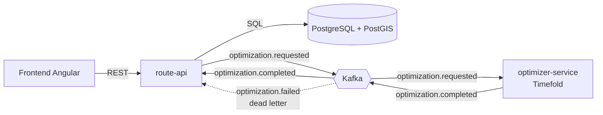

# RutaFlex

[](https://github.com/delmocss/rutaflex/actions/workflows/ci.yml)

Optimización de rutas de reparto para una pequeña empresa de paquetería: recibe las paradas del día y la flota disponible y devuelve **una ruta por furgoneta** que respeta capacidad y franjas horarias.

> Estado: **en construcción** (MVP previsto para el 31 de enero). Lo que hay hoy es el esqueleto: módulos, infraestructura local, esquema de base de datos y CI. Esta tabla se actualiza con cada fase.

| Fase | Contenido | Estado |
|---|---|---|
| 1 | Esqueleto: Maven multi-módulo, `docker compose`, Flyway, CI | ✅ |
| 2 | Almacén, furgonetas y paradas (PostGIS), importación CSV | ⏳ |
| 3 | Optimizador con Timefold y sus restricciones | ⏳ |
| 4-5 | Kafka: trabajo asíncrono, idempotencia, dead letter, test de extremo a extremo | ⏳ |
| 6 | Restricciones reales y medición de km ahorrados | ⏳ |
| 7 | Angular + Leaflet y JWT con dos roles | ⏳ |
| 8-9 | Despliegue, documentación y vídeo | ⏳ |

## Arquitectura

Dos servicios Spring Boot en un mismo repositorio que **solo se hablan a través de Kafka**. La API es la única que toca la base de datos.



| Módulo | Qué es |
|---|---|
| `common-events` | Contrato entre servicios: nombres de topics y eventos. Java puro, sin Spring. |
| `route-api` | API REST y dueña de los datos (Flyway + PostGIS). |
| `optimizer-service` | Consume el problema, calcula las rutas y publica el resultado. Sin base de datos. |

## Stack

Java 21 · Spring Boot 3.5 · Maven multi-módulo · PostgreSQL 16 + PostGIS · Flyway · Apache Kafka (modo KRaft) · Timefold Solver 1.x · JUnit 5 + Testcontainers.

Timefold 1.x y no 2.x porque la línea 2.x exige Spring Boot 4 y este proyecto usa Spring Boot 3.

## Ejecutarlo en local

Requisitos: JDK 21, Maven 3.9+ y Docker.

```bash
docker compose up -d                       # PostGIS + Kafka + topics
mvn -B verify                              # compila y pasa todos los tests

mvn -pl route-api spring-boot:run          # http://localhost:8080/actuator/health
mvn -pl optimizer-service spring-boot:run  # http://localhost:8081/actuator/health
```

`docker compose down -v` lo para y borra los datos.

## Tests

`mvn verify` ejecuta, por módulo:

- `common-events`: los eventos viajan como JSON y vuelven iguales.
- `route-api`: PostgreSQL + PostGIS **reales** con Testcontainers (nunca H2): las migraciones de Flyway, la geografía en metros y las restricciones del esquema (jornada válida, franja horaria completa, trabajo fallido con motivo).
- `optimizer-service`: arranca y responde en `/actuator/health`.

El CI de GitHub Actions ejecuta el mismo `mvn verify`.
